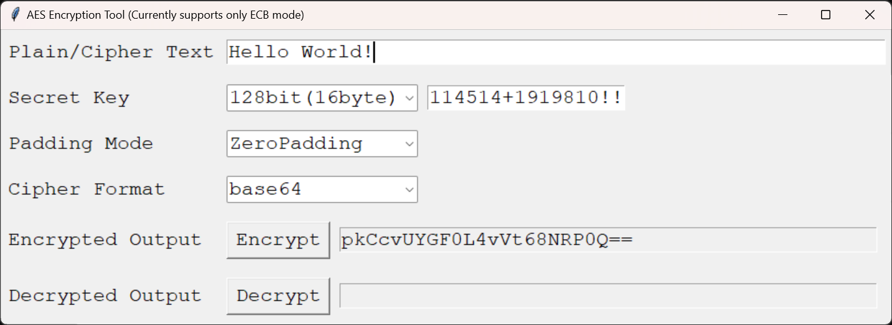

# Minimal Implementation of AES (ECB / GCM) in Python for Windows

[\[English\]](https://github.com/SanJerry007/AES-ECB-Minimal-Windows/blob/master/README-en.md)  |  [\[中文\]](https://github.com/SanJerry007/AES-ECB-Minimal-Windows/blob/master/README.md)

A simple and minimal implementation of AES encryption and decryption in Python, including an executable file with a visual interface for direct use on Windows systems.

Two modes are supported:

- **AES-GCM (recommended):** authenticated encryption with built-in integrity protection; the passphrase is stretched into a key via scrypt. **Suitable for storing passwords and other secrets.**
- **AES-ECB (learning / legacy only):** the classic codebook mode, which is **insecure** — identical plaintext blocks produce identical ciphertext blocks and there is no integrity check. Do not use it for real sensitive data.

## Usage

If you are using the Windows system, directly run the executable file `./EN/AES-ECB-Tool.exe`.

If you want to modify the code by yourself, first you should install the dependency:

```shell
pip install pycryptodome
```

> ⚠️ Not `pip install crypto`. `crypto` is an unrelated, abandoned empty package; this project depends on `pycryptodome` (which provides the `Crypto` namespace). If you previously installed `crypto`, consider `pip uninstall crypto` to avoid confusion.

Then you can feel free to change the code in `./EN/AES-ECB-Tool.py` as per your requirements.

To pack a Python script into a portable `.exe` file, I suggest using the [PyInstaller](https://pyinstaller.org/en/stable/):

```shell
pip install pyinstaller
pyinstaller ./EN/AES-ECB-Tool.py --onefile --windowed
```

Then the executable will be generated to `./dist/AES-ECB-Tool.exe`.

## How to store passwords with it (GCM mode)

**To encrypt and save:**

1. Open the tool and set "Cipher Mode" to **GCM** (it is the default).
2. In "Plain/Cipher Text", type the password you want to save (e.g. a website login password).
3. In "Passphrase", type a **master passphrase only you know** (any length; longer and more random is safer). This is the single key that unlocks every ciphertext — remember it well, as it **cannot be recovered if lost**.
4. Choose `base64` (shorter) or `hex` for "Cipher Format".
5. Click "Encrypt" and copy the whole string from "Encrypted Output" into your notes/file.

**To decrypt and retrieve:**

1. Set "Cipher Mode" to **GCM** as well, and keep "Cipher Format" the same as when encrypting.
2. Paste the saved ciphertext into "Plain/Cipher Text".
3. Enter the **same master passphrase** you used to encrypt.
4. Click "Decrypt"; "Decrypted Output" is your original password.

**Notes:**

- Even with identical content and passphrase, each encryption produces a different ciphertext (random salt + random nonce). This is normal and more secure.
- If the passphrase is wrong, or the ciphertext is altered by even a single character, decryption fails with "wrong passphrase or tampered ciphertext" — that is GCM's integrity protection at work.
- The master passphrase is never stored anywhere; keep it safe yourself.
- This is a minimal tool for light personal use. To manage many passwords, prefer a mature password manager (e.g. KeePassXC, Bitwarden).

## Supported Functions

- **AES-GCM authenticated encryption** (recommended; built-in integrity check, scrypt-based key derivation)
- AES-ECB encryption & decryption (learning / legacy only)
- Visual Interface for Windows
- Variable secret key length for ECB mode:
  - 128bit (16byte)
  - 192bit (24byte)
  - 256bit (32byte)
- Various padding methods for ECB mode:
  - ZeroPadding
  - PKCS7
  - AnsiX923
  - ISO10126
  - ISO97971
- Multiple cipher formats:
  - Base64
  - Hex


