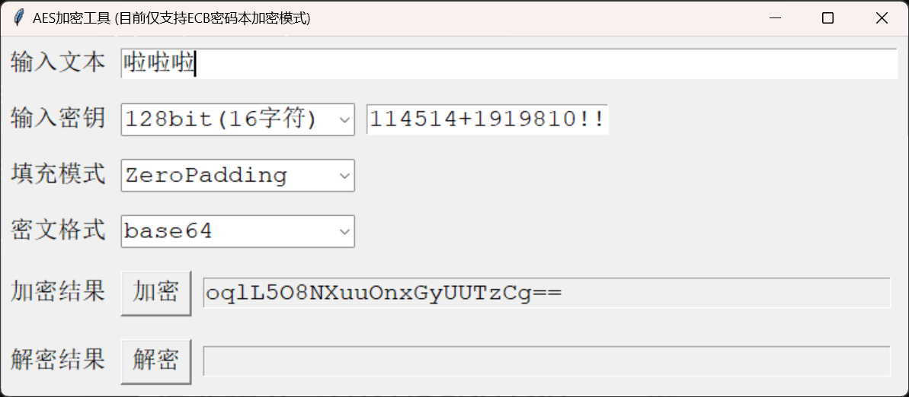

# AES 加密算法最小化实现 (ECB / GCM)

[\[English\]](https://github.com/SanJerry007/AES-ECB-Minimal-Windows/blob/master/README-en.md)  |  [\[中文\]](https://github.com/SanJerry007/AES-ECB-Minimal-Windows/blob/master/README.md)

最小化的 AES 加密解密算法实现(Python)，同时提供了在 Windows 下运行的 exe 文件。

支持两种模式：

- **AES-GCM（推荐）**：认证加密，自带完整性校验，口令经 scrypt 派生密钥。**适合用来保存密码等敏感信息。**
- **AES-ECB（仅供学习/兼容旧数据）**：经典的密码本模式，**不安全**，相同明文块会产生相同密文块且无完整性校验，不要用于保存真实敏感数据。

## 用法

在 Windows 系统下的话，直接运行 `./CN/AES-ECB加密解密工具.exe` 就可以。

如果你要自己改代码，记得先安装依赖:

```shell
pip install pycryptodome
```

> ⚠️ 不是 `pip install crypto`。`crypto` 是一个无关的废弃空包，本项目依赖的是 `pycryptodome`（提供 `Crypto` 命名空间）。如果你之前装过 `crypto`，建议 `pip uninstall crypto` 卸掉以免混淆。

然后就可以随便魔改 `./CN/AES-ECB加密解密工具.py` 里的东西了。

如果你想打包修改后的代码为一个 `.exe` 文件, 可以使用 [PyInstaller](https://pyinstaller.org/en/stable/) 工具:

```shell
pip install pyinstaller
pyinstaller ./CN/AES-ECB加密解密工具.py --onefile --windowed
```

之后你应该就可以在 `./dist/AES-ECB加密解密工具.exe` 找到可执行文件了。

## 如何用它保存密码（GCM 模式）

**加密保存：**

1. 打开工具，「加密模式」选择 **GCM**（默认就是 GCM）。
2. 「输入文本」里填你要保存的密码，例如某网站的登录密码。
3. 「输入口令」里填一个**只有你自己知道的主口令**（任意长度，越长越随机越安全）。这个口令是解开所有密文的唯一钥匙，请务必牢记，**丢了无法找回**。
4. 「密文格式」选 `base64`（更短）或 `hex` 均可。
5. 点「加密」，把「加密结果」里的整串密文复制保存到你的笔记/文件里即可。

**解密取回：**

1. 「加密模式」同样选 **GCM**，「密文格式」与加密时保持一致。
2. 「输入文本」里粘贴之前保存的密文。
3. 「输入口令」里填**当初加密用的同一个主口令**。
4. 点「解密」，「解密结果」就是你的原始密码。

**说明与提醒：**

- 每次加密即使内容和口令完全相同，密文也会不一样（随机盐 + 随机 nonce），这是正常且更安全的表现。
- 如果口令输错，或密文被改动过哪怕一个字符，解密都会失败并提示「口令错误或密文已被篡改」——这正是 GCM 的完整性保护在起作用。
- 主口令本身不会被保存在任何地方，请自行妥善记忆/保管。
- 这是个极简工具，适合个人轻量使用；若要管理大量密码，建议用成熟的密码管理器（如 KeePassXC、Bitwarden）。

## 支持功能

- **AES-GCM 认证加密**（推荐，自带完整性校验，scrypt 口令派生密钥）
- AES-ECB 加密解密算法（仅供学习/兼容）
- Windows 下的可视化操作界面
- ECB 模式支持不同长度的密钥:
  - 128bit (16字符)
  - 192bit (24字符)
  - 256bit (32字符)
- ECB 模式支持不同的填充方法:
  - ZeroPadding
  - PKCS7
  - AnsiX923
  - ISO10126
  - ISO97971
- 支持多种密文格式:
  - Base64
  - Hex


